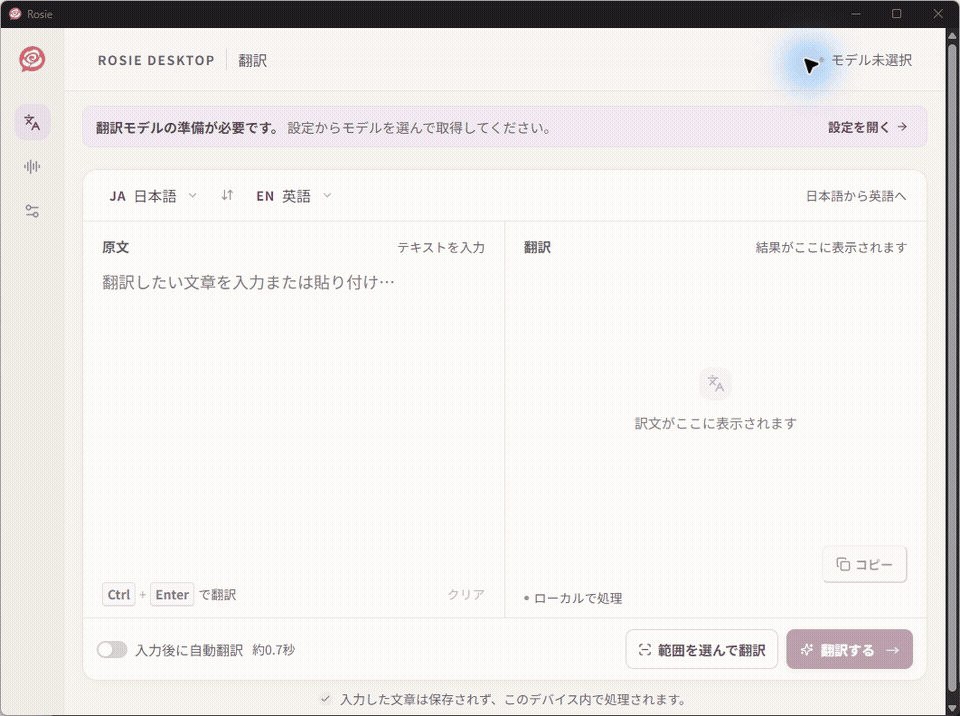
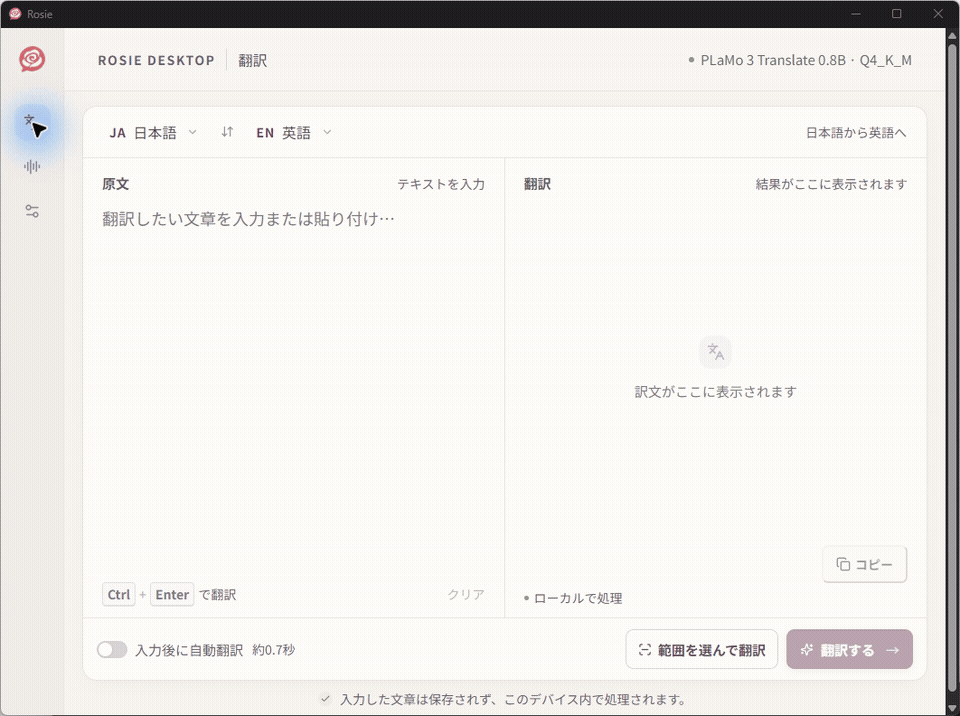
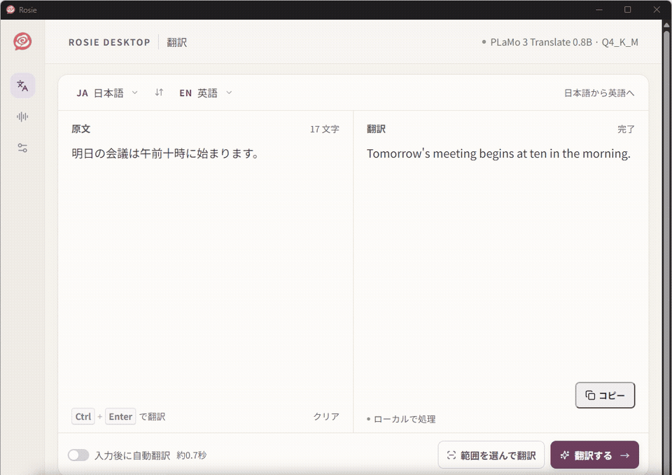
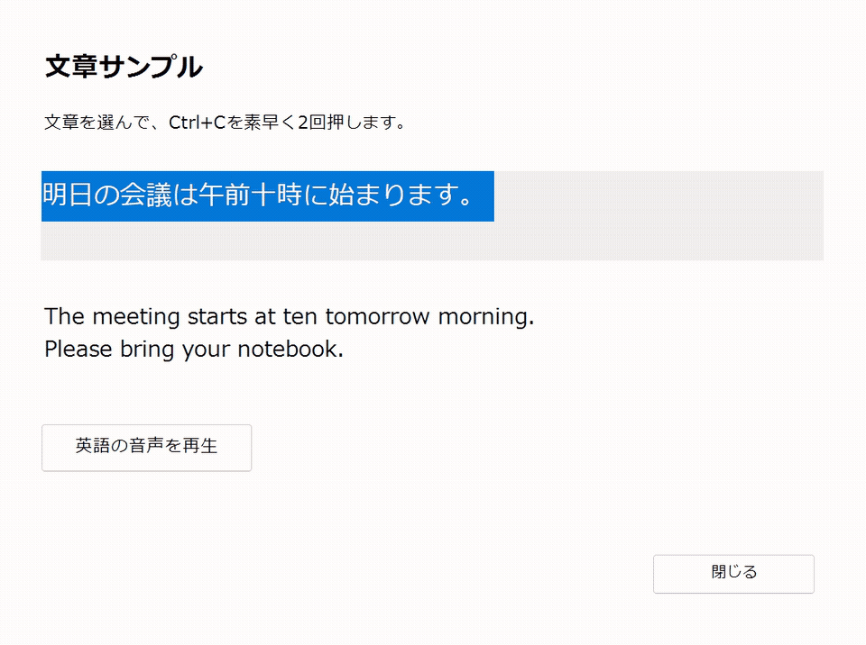
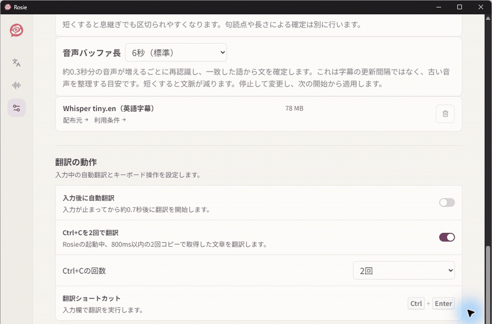
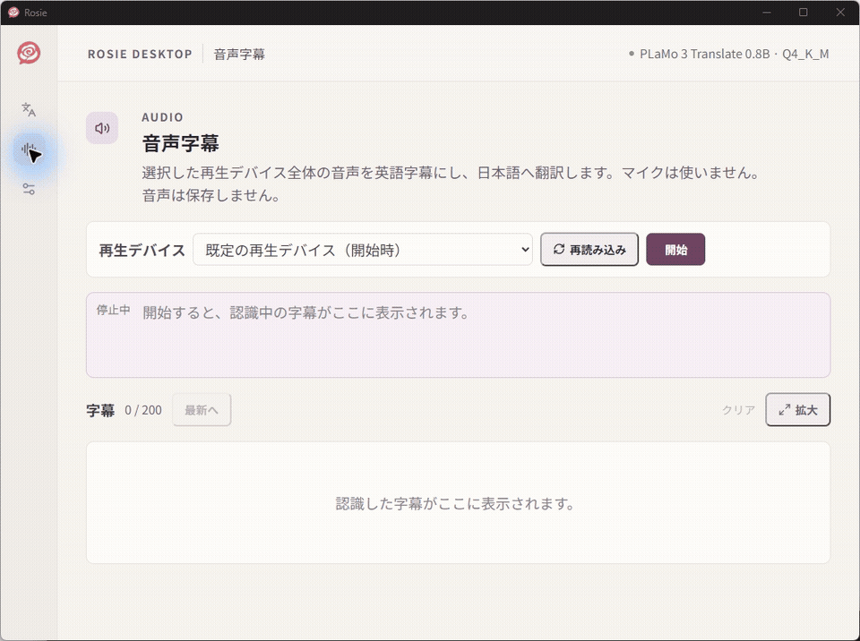
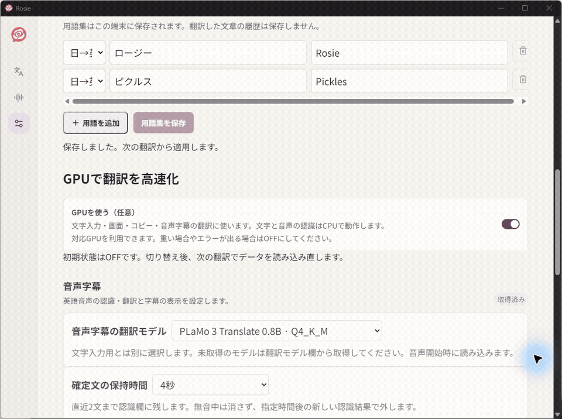
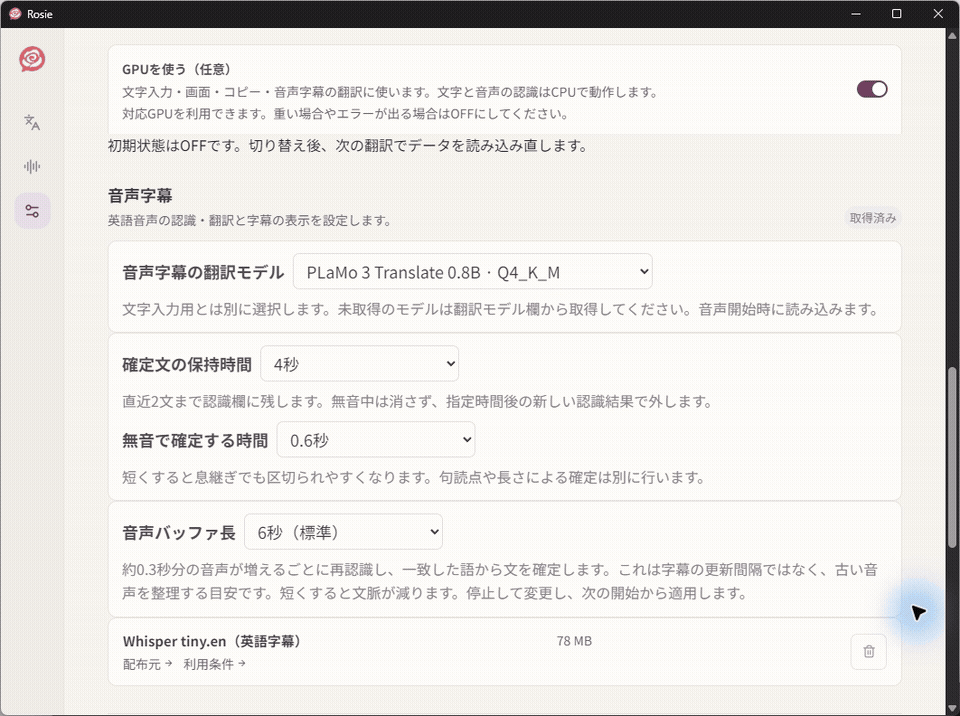
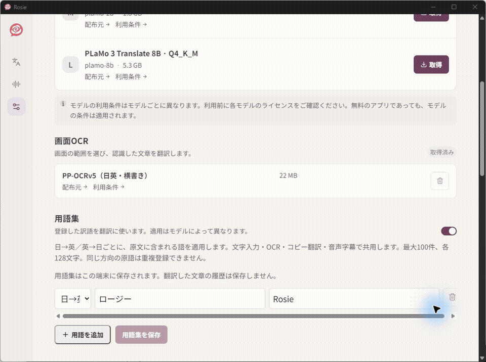

# Rosie 1.0 ご利用ガイド

Rosieは、英語と日本語を翻訳するWindows用アプリです。文章を入力するほか、画面の文字を囲んだり、他のアプリで文章をコピーしたりして翻訳できます。英語の動画などを再生しながら、英語字幕と日本語訳を読むこともできます。

最初に、使いたい機能に必要なデータをダウンロードします。アプリではこのデータを「モデル」と呼びます。準備が済めば、翻訳や文字・音声の読み取りを自分のPC内で行えます。

## はじめかた：ダウンロードから最初の翻訳まで

1. [Windows用ZIPをダウンロード](https://github.com/pickles/rosie-downloads/releases/download/v1.0.0/Rosie-1.0.0-Windows-x64.zip)します。[リリースページ](https://github.com/pickles/rosie-downloads/releases/tag/v1.0.0)でも入手できます。
2. ZIPを右クリックして「すべて展開」を選びます。ZIPの中から直接起動せず、フォルダー全体を展開してください。
3. ブロックされている場合は、展開した `rosie.exe` を右クリックし、「プロパティ」→「全般」の下部にある「許可する」（ブロックの解除）を選んで「適用」を押します。この版には発行元を証明する電子署名がありません。「許可する」がない場合、この操作は不要です。ダウンロード元が正しいことを確認してから操作してください。
4. `rosie.exe` をダブルクリックします。ほかのEXE・DLLやフォルダーも必要なので、`rosie.exe` だけを移動しないでください。
5. 左側の「設定」を開き、「翻訳モデル」の **0.8B** の「取得」を押します。これは翻訳に必要なデータです。最初は容量の小さい0.8B（約573 MB）からお試しください。
6. ダウンロードが終わったら「選択」を押します。確認・読み込みの表示が終わるまで待ちます。「取得」だけでは、使用するデータの選択は完了しません。
7. 左側の「翻訳」に戻り、原文が日本語なら「日本語 → 英語」、英語なら「英語 → 日本語」にします。
8. 「原文」に文章を入力し、「翻訳する」を押します。訳文が表示されたら準備完了です。

### ブロック解除をしても起動できない場合

展開したファイルにブロックが残る場合は、ダウンロードした元のZIPの「プロパティ」で「許可する」を適用し、新しいフォルダーへもう一度すべて展開してください。Windowsの警告とファイルのブロック解除は別の仕組みなので、解除後も警告が出る場合があります。会社・学校のPCで実行が制限されている場合は管理者に確認してください。

GIFは実際のRosieを操作した録画です。説明用の文章を使い、待機時間の一部を短縮しています。処理時間はPCによって異なります。

## 画面の見かた

左側のボタンで、次の3つの画面を切り替えます。アイコンにマウスを重ねると名前が表示されます。

| 画面 | ここでできること |
| --- | --- |
| 翻訳 | 文章を入力して翻訳する、画面の文字を囲んで翻訳する。 |
| 音声字幕 | PCから聞こえる英語を、英語字幕と日本語訳で読む。 |
| 設定 | 必要なデータを取得する、コピー翻訳をONにする、字幕や用語集を調整する。 |

## 文章を入力・貼り付けて翻訳する

1. 「翻訳」を開き、文章に合う翻訳方向を選びます。矢印ボタンで日本語と英語を入れ替えられます。
2. 「原文」に文章を入力、または貼り付けます。
3. 「翻訳する」を押します。入力欄で **Ctrl+Enter** を押しても翻訳できます。
4. 完成した訳文は、訳文欄のコピーボタンでコピーできます。

「入力後に自動翻訳」をONにすると、入力を止めてから約0.7秒後に翻訳を始めます。書き終わってから翻訳したい場合はOFFにしてください。処理を止めるには「キャンセル」、原文を消すには「クリア」を押します。

文章の入力、翻訳、訳文のコピーまでを実際に操作しています。

## 画面に表示されている文字を翻訳する

コピーできない画像や、画面に表示された文章に使えます。

1. 最初に「設定」で画面の文字を読むためのデータを取得します。アプリでは「OCR」と表示されます。
2. 翻訳したい文章を画面に表示し、Rosieで翻訳方向を合わせます。
3. 「範囲を選んで翻訳」を押し、文字のある部分をドラッグして囲みます。
4. 読み取った文章と訳文が表示されます。読み間違いがあれば「原文」を直して、もう一度「翻訳する」を押します。

範囲選択をやめるには **Esc** または右クリックを使います。文字が小さい場合は元の画面を拡大してから囲んでください。横書きの本文向けで、縦書き・段組・回転した文字には対応していません。

## 他のアプリでコピーして翻訳する

ブラウザーや文書を読みながら、選んだ文章をRosieへ送れます。

1. 「設定」→「翻訳の動作」で「Ctrl+Cを2回で翻訳」をONにします。初期状態はOFFです。
2. 「Ctrl+Cの回数」で2回または3回を選びます。普段のコピーで反応しやすい場合は3回にしてください。
3. Rosieの翻訳方向を合わせ、Rosieを起動したまま他のアプリへ戻ります。
4. 翻訳したい文字を選択し、**Ctrl+Cを素早く指定回数**押します。最初から最後まで800ms以内が目安です。
5. Rosieに文章が取り込まれ、訳文が表示されます。

通常の1回のコピーはそのまま使えます。不要なときは設定をOFFにしてください。コピー元のアプリによっては動作しない場合があります。

## 英語の音声を字幕と日本語訳で読む

動画や配信など、PCで再生している英語音声が対象です。マイクの音声や日本語音声の認識には対応していません。

1. 「設定」の「音声字幕」で、英語を聞き取るためのデータ「Whisper」の「取得」を押します。
2. 同じ設定内の「音声字幕の翻訳モデル」で、取得済みの翻訳用データを選びます。文字入力用とは別の選択です。迷った場合は0.8Bからお試しください。
3. 左側の「音声字幕」を開きます。
4. 「再生デバイス」で、動画などの音が出ているスピーカーまたはヘッドホンを選びます。接続し直したときは「再読み込み」を押します。
5. 英語の音声を再生し、Rosieの「開始」を押します。
6. 上部に聞き取り途中の英語が表示され、文章が確定すると下の一覧に英語と日本語訳が追加されます。
7. 終わったら「停止」を押します。音声の取得は自分で「開始」を押したときだけ行います。

選んだスピーカーやヘッドホンから流れる音全体が対象です。別の動画や通知音も一緒に入るため、不要な音を止めると読み取りやすくなります。

「拡大」で字幕をウィンドウいっぱいに表示し、「元に戻す」またはEscで戻れます。「最新へ」で新しい字幕へ戻れます。「クリア」は停止中に使えます。字幕一覧は最大200件で、上限を超えると古い字幕から消えます。

音声字幕の実行中は、文章の翻訳や一部の設定変更ができません。変更したいときは音声字幕を停止してください。

録画では、説明用の英語音声をPCで再生し、字幕と日本語訳が表示される様子を収録しています。途中の「音声の途切れを検出しました」は、取りこぼしを知らせる表示です。表示された場合は聞き取れていない部分があり得ます。

## 設定の説明

### 翻訳に使うデータ（画面の「翻訳モデル」）

文章の意味を読み取り、日本語・英語へ訳すためのデータです。「0.8B」「2B」「8B」は種類の名前で、数字が大きいほど多くのメモリーと処理時間が必要になります。最初は0.8Bで使い、必要に応じてほかの種類を試してください。大きければ必ず正しい訳になるわけではありません。

| 操作・項目 | 意味 |
| --- | --- |
| 取得 | 必要なデータをインターネットからダウンロードします。 |
| 中断 | ダウンロードを止めます。翻訳用データは後から再開できます。 |
| 選択 | 文字入力・画面・コピー翻訳に使う種類を切り替えます。確認と読み込みに時間がかかる場合があります。 |
| ごみ箱ボタン | 取得したデータを削除して空き容量を増やします。再び使うには再取得が必要です。 |
| 配布元・利用条件 | データの提供元と、使うときの条件を確認できます。 |

### 画面の文字を読むデータ（OCR）

画面の画像から文字を読み取るためのデータです。「取得」すれば画面の範囲翻訳に使えます。文章を直接入力するだけなら取得は不要です。翻訳用データもあわせて必要です。

### GPUを使う（任意）

GPUは、PCの画像処理などを担当する部品です。対応するPCでは翻訳にも使えます。初期状態はOFFで、CPU（PCの中心となる処理装置）で翻訳します。

「設定」の「GPUを使う（任意）」をONにすると、次の翻訳からGPUを使います。文字入力・画面・コピー翻訳と、音声字幕の日本語への翻訳に共通して適用されます。画面から文字を読む処理と、英語音声を文字にする処理はCPUで行います。

対応するVulkanドライバーとGPUの空きメモリーが必要です。利用できないPCではONにできません。ONで読み込みに失敗したり動作が不安定になったりする場合は、0.8Bを選ぶか、この設定をOFFにしてCPUへ戻してください。速度はPCと翻訳用データによって変わります。翻訳中・音声字幕の実行中は切り替えられません。

### 音声字幕

まずは初期値のまま試し、気になるところだけ変えてください。音声を停止してから変更します。

| 設定 | 意味・変えるとどうなるか |
| --- | --- |
| 音声字幕の翻訳モデル | 聞き取った英語を日本語へ訳すデータを選びます。文字入力用とは別です。未取得の種類は、上の「翻訳モデル」で取得してから選びます。 |
| 確定文の保持時間 | 上部の認識欄に、直近の確定した文章を最大2文残す時間です。初期値は4秒。「保持しない」または2・4・6・10・15・30秒を選べます。無音中に時間だけで消えるのではなく、指定時間を過ぎて新しい認識結果が来ると外れます。下の字幕一覧を消す設定ではありません。 |
| 無音で確定する時間 | 話し声が途切れてから文章を区切るまでの目安です。初期値は0.6秒。0.2・0.4・0.6・0.8・1・1.5・2・3秒から選びます。息継ぎで文が細切れになる場合は長めにします。句読点や文章の長さでも区切るため、この秒数だけで決まるわけではありません。 |
| 音声バッファ長 | 聞き取りのために直前の音声をどのくらい持っておくかの目安です。2〜8秒、標準は6秒。短くすると前後のつながりを判断する材料が減ります。字幕を何秒ごとに更新するかの設定ではありません。変更は次の「開始」から適用されます。 |
| Whisperの取得・削除 | 英語音声を文字にするデータをダウンロード、または削除します。音声字幕を使わない場合は不要です。 |

### 用語集

人名や製品名など、「この言葉はこう訳してほしい」という組み合わせを登録できます。

1. 「設定」の「用語集」で「用語を追加」を押します。
2. 日→英または英→日を選び、「原語」に元の言葉、「訳語」に使いたい訳を入力します。
3. 「用語集を使う」をONにし、**「用語集を保存」**を押します。入力だけでは保存されません。

文字入力・画面・コピー・音声の翻訳で共通して使います。最大100件、原語・訳語はそれぞれ128文字までです。同じ方向で同じ原語は重複登録できません。訳への反映は翻訳に使うデータによって異なり、必ず指定どおりになるとは限りません。

### 翻訳の動作・アプリの情報

| 設定・表示 | 意味 |
| --- | --- |
| 入力後に自動翻訳 | ONにすると入力が止まって約0.7秒後に翻訳します。OFFならボタンかCtrl+Enterで翻訳します。翻訳画面のスイッチと同じ設定です。 |
| Ctrl+Cを2回／3回で翻訳 | 他のアプリでコピーした文章を取り込む機能のON/OFFです。初期状態はOFFです。 |
| Ctrl+Cの回数 | コピー翻訳を始める操作を2回または3回から選びます。 |
| 翻訳ショートカット | 入力欄で使えるCtrl+Enterの案内です。キーを変更する項目ではありません。 |
| Rosieについて | バージョンと、アプリで使っているソフトウェアのライセンスを確認できます。 |

用語集以外の切り替えや選択は、その操作で保存されます。処理中で操作できない場合は、翻訳・データの準備・音声字幕が終わるまで待ってください。

## 必要なPC・インターネット接続

- Windows 11の64ビット版（x64）、AVX2対応CPUが必要です。ARM64・macOSには対応していません。
- 初期状態はCPUで処理します。対応するPCでは設定からGPUを任意で有効にできます。
- 必要なデータのダウンロードにはインターネット接続とディスクの空き容量が必要です。取得後はオフラインでも使えます。
- メモリーの使用量と待ち時間は、選ぶデータの種類や文章量、PCによって変わります。
- Microsoft Edge WebView2 Runtimeが必要です。起動できない場合は下の対処を確認してください。

## 困ったとき

### 初回の確認

- ZIPをすべて展開しましたか。
- ブロックされている場合は「プロパティ」の「許可する」を適用しましたか。
- 翻訳用データの「取得」が終わり、「選択」も済みましたか。
- 原文に合う翻訳方向を選びましたか。

### 起動しない

フォルダー内のEXE・DLL・resourcesなどが揃っているか確認します。ほかのRosieが起動していれば終了してから起動してください。WebView2 Runtimeがない場合は、[Microsoft公式ページ](https://developer.microsoft.com/microsoft-edge/webview2/)から導入します。Windowsや組織の実行制限がある場合は管理者に確認してください。

### 取得できない・翻訳が始まらない・遅い

インターネット接続と空き容量を確認してください。翻訳用データは取得を中断しても後から再開できます。「確認中」「読み込み中」の表示が出ている間は待ちます。重い場合は0.8Bを試し、長い文章は短く分けてください。破損が表示された場合は設定から該当データを削除し、再取得します。

### 画面の文字が違って読み取られる

元の画面を拡大し、横書きの本文だけを囲んでください。読み取った「原文」を修正してから再翻訳できます。

### コピー翻訳が反応しない

Rosieが起動していること、設定がONであること、回数が合っていることを確認してください。文字を選んでCtrl+Cを素早く押します。コピー元のアプリによっては動作しないため、直接貼り付ける方法もお試しください。

### 音声字幕が出ない・間違う

音が出ているスピーカーやヘッドホンと「再生デバイス」の選択を合わせます。英語音声を再生して「開始」を押してください。マイク音声は対象外です。別の音を止めると改善する場合があります。処理が追いつかない場合は、ほかの重い処理を終了するか、小さい翻訳用データを選んでください。

### ファイルが揃っているか調べたい

配布フォルダーの `VERIFY.cmd` を実行すると、ファイルの不足や変化を調べられます。任意の補助機能で、普段の利用で実行する必要はありません。PASSは同梱の一覧と一致したという意味で、すべての機能の動作保証ではありません。結果は `results` フォルダーに保存されます。`VERIFY-RUNTIME.cmd` は問題の調査で案内された場合に使います。

### 不具合を報告したい

「Rosieについて」のバージョン、Windowsのバージョン、行った操作、エラーメッセージをお知らせください。原文・訳文・画像・音声や個人情報を送る必要はありません。

## 更新・削除と保存データ

更新するときはRosieを終了し、新しいZIPを別フォルダーへすべて展開して起動します。同じWindowsユーザーなら設定・取得済みデータ・用語集を引き継ぎます。自動更新機能はありません。

設定・取得したデータ・登録した用語は `%LOCALAPPDATA%\io.github.pickles.rosie` に保存します。原文・訳文・画面画像・音声・字幕の履歴は保存しません。コピーした内容はWindowsのクリップボードに残ります。

アプリを削除するときは、Rosieを終了して展開したフォルダーを削除します。設定・取得したデータ・用語集も不要な場合だけ、上記の保存先を削除してください。この操作で登録した用語も消え、元には戻せません。

## 利用上の注意・ライセンス

翻訳や読み取りには誤りが含まれることがあります。必要に応じて原文と照合してください。

アプリで使っているソフトウェアやデータの条件は、設定の「Rosieについて」「利用条件」と同梱の `notices` で確認できます。翻訳・文字認識・音声認識に使うデータには、それぞれ提供元の条件が適用されます。

Built with PLaMo
